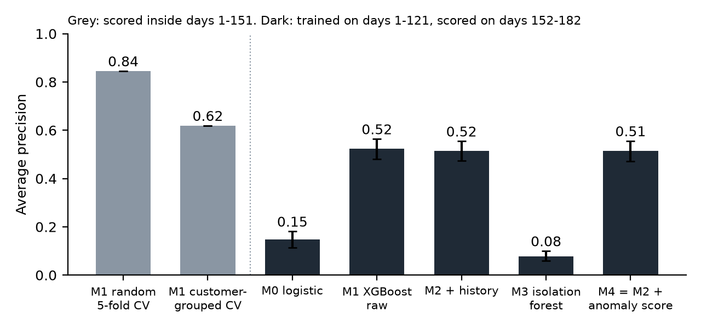
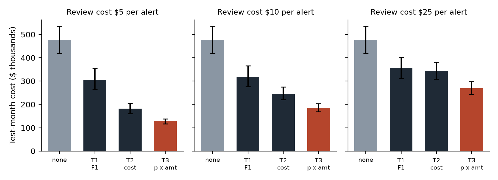
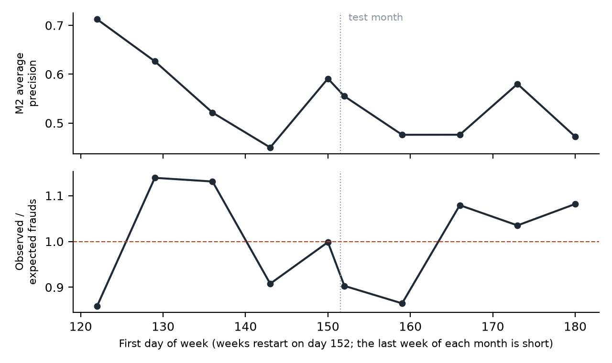

# Readout

All numbers are from the test month (days 152-182: 89,326 transactions, 3,114 frauds, $477,356 of fraud), with models trained on days 1-121 and tuned or calibrated on days 122-151, as fixed in [design.md](design.md) before any model was fitted. Intervals are 95% bootstrap intervals over 1,000 resamples of customer groups. Tables are in `results/`.

## Summary

- A random split makes the same model look much better than it is. Random 5-fold cross-validation gives an average precision (AP) of 0.84; the model trained on earlier months scores 0.52 on the next month. Holding out whole customers closes about 70% of that gap (0.62), which fits the host's labelling rule: once a card has a chargeback, later transactions linked to the same account, e-mail or address are labelled fraud too.
- The customer-history features did not help (AP 0.516 vs 0.524), and neither did an isolation forest score. Vesta's own count and time-delta columns already carry this information.
- The biggest gain came from the decision rule, not the model. Flagging a transaction when calibrated fraud probability × amount ≥ the $10 review cost lost $185,000 in the test month, against $319,000 for the F1-optimal cut-off (42% less) and $246,000 for the best single cut-off chosen on validation (25% less).
- Calibration fitted on the validation month still held a month later: 3,114 frauds observed against 3,182 expected.

## Pre-registered predictions

| | Prediction | Result | Verdict |
|---|---|---|---|
| P1 | Random-split AP exceeds time-split AP by at least 0.05, grouped CV in between | random 0.845, customer-grouped 0.619, time split 0.524 (0.481-0.564) | Met |
| P2 | History features raise AP (M2 − M1 > 0) | −0.008 (−0.017 to 0.002) | Not met |
| P3 | Isolation forest AP below half of M1's, and adding it changes AP by less than 0.01 | AP 0.077 vs 0.524; M4 − M2 = −0.002 (−0.011 to 0.007) | Met |
| P4 | At $10 per alert, the Bayes minimum risk rule costs less than the F1 cut-off | −$133,681 (−$173,195 to −$96,111), −42% | Met |
| P5 | Observed / expected frauds in the test month falls outside 0.9-1.1 | 0.98 (0.91 to 1.05) | Not met |

## Models

| Model | AP (95% interval) | ROC AUC | Frauds caught at 2% alert rate | Fraud dollars caught at 2% |
|---|---|---|---|---|
| M0 logistic, small feature set (F0) | 0.147 (0.115-0.181) | 0.757 | 14% | 7% |
| M1 XGBoost, 431 raw columns | 0.524 (0.481-0.564) | 0.885 | 40% | 32% |
| M2 M1 + 6 history features | 0.516 (0.473-0.554) | 0.889 | 39% | 29% |
| M3 isolation forest, no labels | 0.077 (0.060-0.100) | 0.713 | 2% | 3% |
| M4 M2 + isolation forest score | 0.514 (0.471-0.555) | 0.887 | 39% | 30% |

The isolation forest's AP of 0.077 is about twice the 3.5% base rate, but at a 2% alert rate it catches about as many frauds as random flagging would. Unusual transactions and fraudulent ones are mostly different sets here.

## Decision rules in dollars

Every flagged transaction costs a review fee c; every fraud let through costs its amount. All rules use M2 scores.

| Review cost | Rule | Test-month cost | Alert rate | Frauds caught | Fraud dollars caught |
|---|---|---|---|---|---|
| — | flag nothing | $477,356 | 0% | 0% | 0% |
| $10 | T1: cut-off with best F1 on validation | $318,706 | 2.8% | 46% | 38% |
| $10 | T2: cut-off with lowest validation cost | $246,377 | 12.1% | 72% | 71% |
| $10 | T3: flag if calibrated p × amount ≥ $10 | $185,025 | 8.8% | 56% | 78% |

T3 flags fewer transactions than T2 and catches fewer frauds, yet more fraud dollars: it lets through small frauds that are not worth a $10 review and flags large purchases whose fraud probability is modest. The ranking held at $5 and $25 per alert: T3 cost 30% and 22% less than T2, and 59% and 24% less than T1, with every interval below zero (`results/policy_comparisons_test.csv`).

## Calibration and drift

Isotonic calibration fitted on the validation month gave a test-month observed-to-expected ratio of 0.98. By probability decile, predicted and observed rates are close in the top three deciles (0.018 vs 0.022, 0.039 vs 0.041, 0.263 vs 0.239), while the lowest deciles are underpredicted (0.2-0.3% predicted, 0.3-0.5% observed), where little money is at stake (`results/calibration_test.csv`). Week by week, the ratio moved between 0.86 and 1.08 in the test month and AP between 0.47 and 0.58, with no steady decline. Calibration therefore looks stable at the month level but noisy at the week level; a monitoring rule based on one week would raise false alarms.

## Label delay (S1)

Refitting M2 without the last 30 days of training labels, as if those chargebacks had not arrived yet, changed test AP by −0.011 (−0.026 to 0.005) and T3 cost at $10 by +$6,872 (+3.7%, −$7,339 to +$23,487). On this data a month of missing labels costs little.

## Limits

- The money results depend on assumed costs. Every alert costs the same whether the transaction is fraud or not, and a false decline costs nothing beyond the review fee, so lost sales and customer friction are ignored. T3 at $10 flags 8.8% of transactions, which a real review team may not have the capacity for.
- There is no customer ID. The proxy (card1, addr1, e-mail domain) drives both the history features and the clustered bootstrap; a better link would probably widen the intervals.
- Labels follow the host's rule, so some "fraud" transactions are later purchases linked to an earlier chargeback rather than separate fraud attempts.
- One split and one test month; no retraining schedule was tested.
- Changes made after the first results run, none affecting a point estimate: the bootstrap code divided 0 by 0 when the first rows of a resample had zero weight, which gave missing intervals in the first run and was fixed before any interval was read; weekly windows were restarted at day 152 so that no week mixes the two months. Implementation details not stated in the design: early stopping used XGBoost's built-in area under the precision-recall curve, and for the isolation forest a missing time since the previous transaction was set to the last timestamp in the data and a missing amount ratio to 1.

## Data and rules

IEEE-CIS Fraud Detection, Kaggle (2019), data from Vesta Corporation, used under the competition rules for non-commercial academic research and education. No data or row-level results are in this repository.

Reference: Correa Bahnsen, A., Stojanovic, A., Aouada, D. and Ottersten, B. (2013). Cost sensitive credit card fraud detection using Bayes minimum risk. *12th International Conference on Machine Learning and Applications (ICMLA)*, 333-338. doi:10.1109/ICMLA.2013.68.
